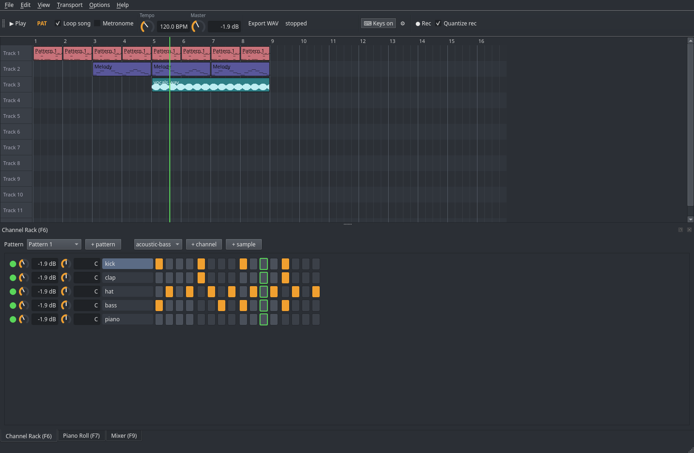
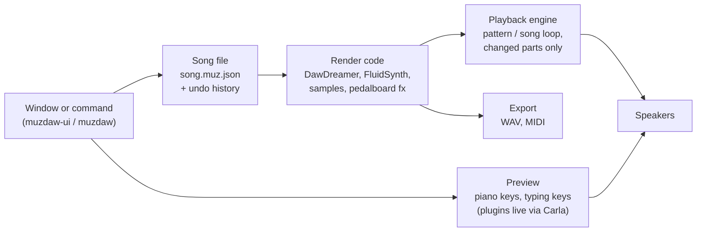

# muzdaw

**An FL Studio style music maker for Linux, written in Python: Channel Rack, Piano Roll, Playlist and Mixer in a window, and every action also as a command.**




## What is muzdaw?

Making a beat or a short song for a video should not need a heavy studio app, and a song should also be something a script can build. muzdaw keeps the whole song in one small JSON file and gives you two ways to work on it:

| Way | What you get |
|---|---|
| **Window** (`muzdaw-ui`) | Channel Rack step sequencer, Piano Roll, Playlist with patterns and audio clips, Mixer with effects, FL style keys |
| **Commands** (`muzdaw`) | Every edit as a command: add channels and notes, effects, render to WAV, MIDI in and out, audio to notes |

Sound comes from built-in synths, General MIDI (FluidSynth), VST3/VST2 plugins (Surge XT, Odin2, Dexed, Cardinal, ZynAddSubFX…) and your own audio files. What you hear when you press Space is rendered by the same code as the WAV export, so the export sounds exactly the same.

## Features

- **Pattern and song mode:** Space loops the selected pattern (PAT) or plays the whole Playlist (SONG)
- **Hear edits while it plays:** only changed instruments are rendered again, then swapped in at the same spot
- **Piano Roll:** select, box select, copy/paste, duplicate, move with the arrow keys, right-drag to erase, velocity lane, quantize
- **Play notes three ways:** click the piano keys (hold = long note, left end soft, right end hard), type on the computer keyboard (three rows, octave and start note per row), or a MIDI keyboard
- **Record** the computer keyboard into a pattern with a count-in while the pattern plays, loop recording, optional quantize
- **Audio samples:** any WAV/FLAC/MP3/OGG as a one-shot instrument, or as an audio clip on the Playlist (drag and drop)
- **Mixer:** volume, pan, mute, 18 built-in effects plus VST3 effects, buses and sends
- **Audio to notes:** turn a recording into notes in a pattern (basic-pitch)
- **Undo for everything:** every change is saved at once, with undo and redo in the window and on the command line
- **Plugins never open windows:** sound helpers run without a screen; tests run silent and headless

## How it works



## Quick start

Requirements: Linux, Python 3.11 or newer, PipeWire or PulseAudio, FluidSynth with the FluidR3 General MIDI soundfont. Carla and the plugins are optional (needed for plugin sounds and terminal live play).

**1. System packages**

| Distro | Command |
|---|---|
| Arch, CachyOS, Manjaro, EndeavourOS | `sudo pacman -S --needed git python pyside6 fluidsynth soundfont-fluid portaudio carla` |
| Debian 12+, Ubuntu 22.04+ (not tested) | `sudo apt install git python3 python3-venv fluidsynth fluid-soundfont-gm libportaudio2 carla` |
| Fedora (not tested) | `sudo dnf install git python3 fluidsynth fluid-soundfont-gm portaudio Carla` |

Optional plugin sounds and effects (Arch package names):

```sh
sudo pacman -S --needed surge-xt-vst3 odin2-synthesizer-vst3 dexed-vst3 cardinal-vst3 zynaddsubfx \
    lsp-plugins-lv2 lsp-plugins-vst3 dragonfly-reverb-lv2
```

**2. Get muzdaw**

```sh
git clone https://github.com/Muzasio/muzdaw.git
cd muzdaw
```

**3. Python packages**

Arch (uses the system PySide6, so the window library is not downloaded twice):

```sh
python3 -m venv --system-site-packages .venv
.venv/bin/pip install -e .
```

Other distros (PySide6 comes from pip):

```sh
python3 -m venv .venv
.venv/bin/pip install -e ".[ui]"
```

**4. Run**

```sh
.venv/bin/muzdaw-ui            # the window (opens your last song, or a new one)
.venv/bin/muzdaw --help        # all commands
```

Press **F1** in the window for the full guide.

**5. Audio to notes (optional)**

basic-pitch needs Python 3.12, so it gets its own small environment ([uv](https://docs.astral.sh/uv/) makes that easy). Its helpers are installed first and basic-pitch itself without dependencies, because its package asks for TensorFlow, which has no build for Python 3.12 (muzdaw uses the lighter ONNX runtime instead):

```sh
uv venv -p 3.12 .venv-pitch
uv pip install --python .venv-pitch/bin/python librosa mir-eval pretty-midi "resampy<0.4.3" scikit-learn scipy onnxruntime "setuptools<81"
uv pip install --python .venv-pitch/bin/python --no-deps basic-pitch==0.4.0
```

**6. App menu entry (optional)**

Run in the `muzdaw` folder:

```sh
mkdir -p ~/.local/share/applications ~/.local/share/icons/hicolor/scalable/apps
cp muzdaw/ui/icon.svg ~/.local/share/icons/hicolor/scalable/apps/muzdaw.svg
printf '%s\n' '[Desktop Entry]' 'Type=Application' 'Name=muzdaw' 'GenericName=Music maker (DAW)' \
    "Exec=$PWD/.venv/bin/muzdaw-ui %f" 'Icon=muzdaw' 'Terminal=false' \
    'Categories=AudioVideo;Audio;Music;Midi;' 'StartupWMClass=muzdaw' \
    > ~/.local/share/applications/muzdaw.desktop
```

### Remove it

```sh
rm -f ~/.local/share/applications/muzdaw.desktop ~/.local/share/icons/hicolor/scalable/apps/muzdaw.svg
rm -rf ~/.config/muzdaw ~/.local/share/muzdaw
```

Then delete the `muzdaw` folder. Your own songs (`.muz.json` files) stay where you saved them.

## Settings

| Setting | Where | What |
|---|---|---|
| Window size and layout, PAT/SONG, 🔊, Quantize rec | `~/.config/muzdaw/ui.json` | Saved when you close the window |
| Typing keyboard rows, octave, velocity | `~/.config/muzdaw/keyboard.json` | ⚙ next to **⌨ Keys** in the toolbar |
| Last opened song | `~/.config/muzdaw/recent.json` | Opened again on the next start |
| New songs not saved yet | `~/.local/share/muzdaw/` | Use **File → Save as** to keep them elsewhere |
| `MUZDAW_SOUNDFONT` | environment | Path to a General MIDI `.sf2` if it is not in the usual place |
| `MUZDAW_PITCH_PYTHON` | environment | Python of the basic-pitch environment, if not `.venv-pitch` |
| `MUZDAW_SILENT=1` | environment | Nothing is played on the speakers (tests) |

The settings folders are private to your user (folders `700`, files `600`).

## Known limits

- **Linux only.** Sound output uses PortAudio (PipeWire/PulseAudio); plugins are found in the usual Linux folders (`/usr/lib/vst3`, `/usr/lib/lv2`).
- **Plugins:** VST3 and VST2 for sound and export. LV2 and CLAP plugins are used only for terminal live play through Carla.
- **First play of a big song in SONG mode takes a few seconds** (about 9 s for a 2-minute song with 24 instruments); after that, edits are heard within about a second.
- **Terminal live play** (`muzdaw play`, through Carla) uses stand-in sounds for the built-in synths and skips samples and audio clips. The window's Space playback does not have these limits.
- **Samples are one-shot:** a note plays the whole file.
- **Surge XT** has small random analog drift, so two renders of a Surge song are close but not bit-identical.
- **Recording in the window** uses the computer keyboard; a MIDI keyboard records with `muzdaw record-midi`.

## Troubleshooting

| Problem | Fix |
|---|---|
| No sound on Space | PAT mode plays the selected pattern: does it have notes? SONG mode: is a pattern on the Playlist? Is the channel's green dot on and Master turned up? |
| "GM soundfont not found" | Install the FluidR3 soundfont (step 1), or set `MUZDAW_SOUNDFONT=/path/to/file.sf2` |
| Plugin instrument is silent or missing | Install its VST3 package; the Channel Rack sound list shows only installed plugins |
| "audio file not found" | A sample or audio clip file was moved or renamed. Put it back, or add it again |
| "basic-pitch Python not found" | Do step 5, or set `MUZDAW_PITCH_PYTHON` |
| The first key of a Surge sound is slow | Normal: the plugin loads once (about 1-2 s), then every key is instant |
| Something went wrong in the song | **Ctrl+Z** (or `muzdaw undo song.muz.json`) |

## Status

muzdaw is in beta: the window and the commands work and are covered by tests, and Step 7 (automation, MP3 and stem export, tempo sync to Blender frames) is planned.

**Working**
- Window: Channel Rack, Piano Roll with editing and velocity lane, Playlist with patterns and audio clips, Mixer with effects, buses and sends
- Playback engine (PAT/SONG, live edits, playheads), typing keyboard and piano-key previews, recording with count-in
- Instruments: built-in synths, General MIDI, VST3/VST2 plugins, audio samples
- Commands for every edit, WAV render, MIDI import/export, audio to notes, MIDI keyboard recording, undo/redo

**Tested** on CachyOS (Arch based), Python 3.14.9, PySide6 6.12.0, DawDreamer 0.9.0, pedalboard 0.9.26, Carla 2.5.10, KDE Plasma (Wayland): 160 automated tests (headless and silent: rendering, engine output equal to the export, editing, recording, samples, UI clicks and keys) and hands-on use of the window.

**Not tested yet**
- Debian, Ubuntu, Fedora and other distributions
- Recording from a real MIDI keyboard and from a microphone by hand
- Long sessions with many plugin instruments

## License

[GPL-3.0](LICENSE). muzdaw builds on DawDreamer and pedalboard, which are GPL-3.0.
